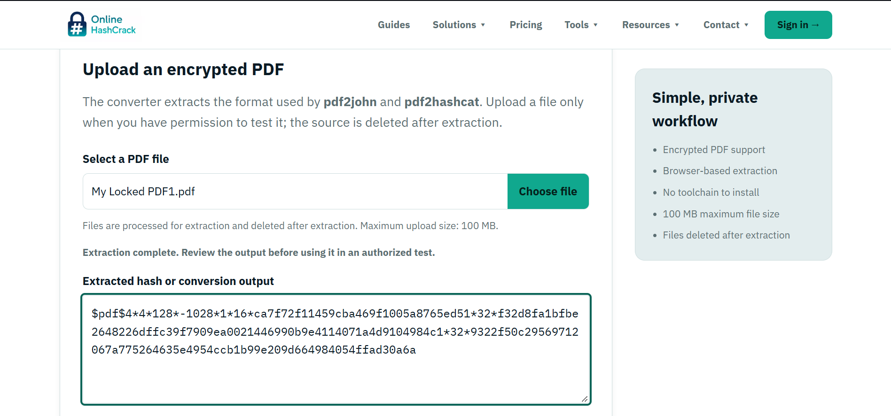
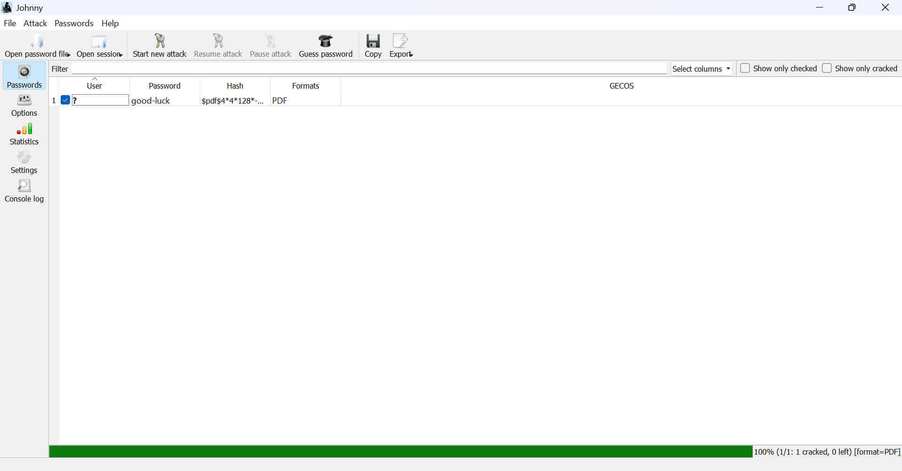

# Module 1: Password Cracking with JTR (John + Johnny)

## Objective
Recover the password of a locked PDF (`My Locked PDF1.pdf`) using John the Ripper and
its GUI front-end, Johnny.

## Step 1: Set up John the Ripper in Johnny
Downloaded John the Ripper and the Johnny GUI from the official Openwall sources and
pointed Johnny to the `john.exe` executable.

## Step 2: Extract the password hash
Uploaded the locked PDF to an online PDF hash extractor to generate the `$pdf$...` hash.

## Step 3: Crack the password
Loaded the hash into Johnny and ran the attack. The password was recovered.

## Step 4: Confirm the result
Opened the PDF with the recovered password and confirmed it opened successfully /
confirmed the captured flag.

## Result
Password for `My Locked PDF1.pdf` successfully recovered using John the Ripper / Johnny.
