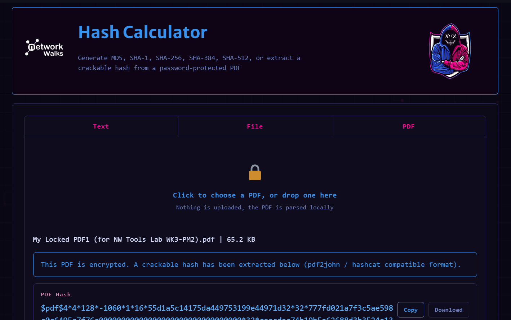
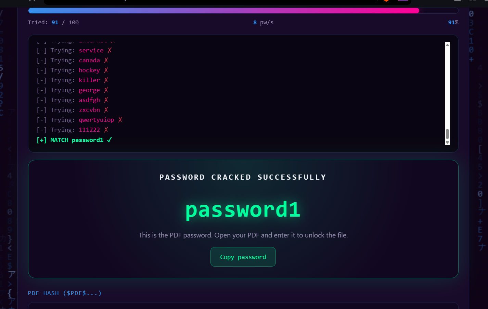

# Module 2: Password Cracking with Networkwalks Tools

## Objective
Recover the password of another locked PDF (`My Locked PDF1.pdf`) using Networkwalks'
browser-based Hash Calculator and Password Cracker tools, with no local install required.

## Step 1: Extract the hash
Uploaded the locked PDF to the Networkwalks Hash Calculator to generate the `$pdf$...` hash.

## Step 2: Run the Password Cracker
Pasted the hash into the Networkwalks Password Cracker and ran the dictionary attack
using the tool's built-in wordlist.

## Step 3: Confirm the result
Opened the PDF with the recovered password and confirmed it opened successfully /
confirmed the captured flag.

**[Screenshot: PDF opened with recovered password]**

## Result
Password for `My Locked PDF1.pdf` successfully recovered using the Networkwalks
Hash Calculator and Password Cracker, confirming the same outcome as Module 1 via a
browser-only workflow.
